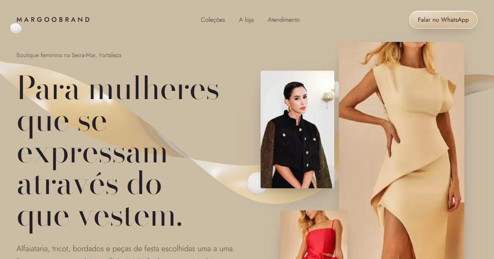

# Margoo Brand — landing page

Landing page da **Margoo Brand**, boutique feminina na Galeria Via Scala, Beira-Mar de Fortaleza. Uma fita de cetim em 3D atravessa a página e gira com o scroll; no fim, as pérolas se juntam num colar. Projeto da **DataCode Studio**.

<!-- GIF da página rolando: docs/demo.gif (gravar depois do deploy) -->


**Site:** _link do deploy na Vercel (entra após a publicação)_

## Notas no Lighthouse

| | Performance | Acessibilidade | Boas práticas | SEO |
|---|---|---|---|---|
| **Celular** | **92** | 100 | 100 | 100 |
| **Desktop** | **99** | 100 | 100 | 100 |

Lighthouse 12, mediana de 3 rodadas, build de produção.

No celular, a página mostra uma imagem estática da própria cena 3D em vez de baixar o 3D ao vivo (~245 kB): é o que mantém a página leve e rápida no 4G sem perder a identidade visual ([ADR 004](docs/adr/004-3d-so-desktop.md)).

Medições completas, com a linha de base e cada otimização, em [docs/performance.md](docs/performance.md).

## Stack

React 19 · Vite · TypeScript estrito · Tailwind CSS v4 · three.js + React Three Fiber · Vitest · ESLint · Vercel

Sem backend, sem banco e sem segredos: é um site estático. Decisões em [docs/adr/](docs/adr/).

## Desafios técnicos

- **Fita de cetim 3D que reage ao scroll.** É uma malha de 240×20 segmentos recalculada a cada quadro, com material de cetim (sheen + clearcoat), pérolas iridescentes e um vento que cresce com a velocidade do scroll. No fim da página, 25 pérolas viram um colar em U que se ajusta à largura da tela. A coreografia toda está em funções puras com testes ([ADR 002](docs/adr/002-3d-fio-colar.md)).
- **Um único motor de animação.** Parallax das fotos, letreiro, títulos deslizando, vitrine fixada e a cena 3D compartilham um só `requestAnimationFrame` (o R3F roda com `frameloop="never"`). A suavização depende do tempo real: em 60 Hz e em 120 Hz o resultado é o mesmo, e há teste provando.
- **3D sem travar a página.**
  - Na primeira versão, o 3D levou a nota do celular de 86 para 44.
  - Medindo cada etapa, apareceram os culpados: shaders compilando de forma síncrona (1,5 s) e o reflexo de ambiente gerado no navegador (2,3 s).
  - A correção: compilação em paralelo, reflexo **pré-calculado no build** (100 kB, codec RGBE próprio com testes; [ADR 003](docs/adr/003-envmap-pre-calculado.md)) e início só depois do LCP.
- **Versão estática para celular e aparelhos fracos.**
  - Uma função pura decide se o aparelho recebe o 3D ao vivo, olhando largura da tela, memória, núcleos, economia de dados, movimento reduzido e GPU.
  - Quem não recebe vê pôsteres renderizados da própria cena, com a mesma câmera e os mesmos materiais.
  - Os pôsteres são desenhados em canvas, para uma imagem decorativa não virar o LCP.
- **Botões de vidro.** Têm luz que segue o cursor, inclinação 3D e reflexo que atravessa o botão. Medido: 58 fps com a fita rodando atrás.
- **Layout verificado num navegador real.** O `npm run check:layout` abre o Chrome headless e confere:
  - que nenhuma foto cobre título, legenda ou botão, em 6 tamanhos de tela, dezenas de posições de scroll e com o mouse nos cantos;
  - o comportamento com movimento reduzido;
  - os links diretos (`/#loja`);
  - que o celular não baixa o 3D.
- **Acessibilidade.** Foco visível, link "pular para o conteúdo", vitrine navegável por teclado e movimento reduzido respeitado. O contraste AA de cada par de cores é verificado num teste que lê as cores direto do CSS.

## Como rodar

Requer Node 22+ e, para os scripts de verificação e geração, o Google Chrome instalado (ou `CHROME_PATH`).

```bash
npm install
npm run dev            # http://localhost:5173
npm run test           # Vitest
npm run lint           # ESLint
npm run build          # tsc + vite build
npm run check:layout   # build + Chrome headless: layout, movimento reduzido, links diretos e modo da cena
```

Geradores (o resultado vai versionado no git):

```bash
npm run images         # fotos WebP 480/960 a partir de referencia/
npm run fonts          # Bodoni Moda e Jost em woff2, do Google Fonts para public/fonts/
npm run bake:env       # reflexo da cena pré-calculado (regerar ao atualizar o three)
npm run bake:posters   # pôsteres estáticos da cena (regerar ao mudar a cena)
npm run bake:social    # imagem de compartilhamento 1200x630 e ícones
```

**Ver o 3D ao vivo num computador com 4 núcleos:** pela regra do ADR 004 ele recebe a versão estática. No Chrome, abra o DevTools (F12), vá na aba **Performance**, clique na engrenagem ⚙️, mude **Hardware concurrency** para 8 e recarregue com o DevTools aberto.

## Deploy na Vercel (plano grátis)

O `vercel.json` já define o build (`npm run build` → `dist/`) e o cache: arquivos de `/assets/` têm hash no nome e ficam em cache por 1 ano; fontes, pôsteres e fotos ficam por 7 dias, porque o nome não muda quando o arquivo muda.

1. Entre em [vercel.com](https://vercel.com) com a conta do GitHub.
2. **Add New → Project** e importe `RichardMIB/margoo-brand-landing`.
3. Confira o que a Vercel detectou: Framework **Vite**, Build `npm run build`, Output `dist`, Node **22.x** (em *Settings → Build and Deployment*, se precisar). Não há variáveis secretas.
4. **Deploy.** A Vercel informa o domínio de produção no build (`VERCEL_PROJECT_PRODUCTION_URL`), e com ele o site gera canonical, `og:url`, `sitemap.xml` e o `robots.txt` apontando o sitemap.
5. **Domínio próprio (opcional):** em *Settings → Domains*, adicione o domínio e siga os registros DNS indicados. Depois, em *Settings → Environment Variables*, crie `SITE_URL=https://seudominio.com.br` (Production) e faça **Redeploy**, para as tags usarem o domínio próprio.
6. Confira em produção:
   ```bash
   curl -sI https://SEU-DOMINIO/ | grep -i -E "x-content-type|referrer"
   curl -s https://SEU-DOMINIO/robots.txt
   curl -s https://SEU-DOMINIO/sitemap.xml
   ```
   - Cole o link no [validador do LinkedIn](https://www.linkedin.com/post-inspector/) ou mande para você mesmo no WhatsApp e veja a prévia com a imagem 1200×630.
   - Rode o Lighthouse na URL de produção e atualize a tabela acima, se mudar.
7. Troque o "_link do deploy_" no topo deste README pelo endereço real.

A partir daí, cada push na `main` publica sozinho, e cada pull request ganha uma URL de prévia.

## Dívida técnica

- **v2: trocar R3F por three puro na cena para reduzir o pacote do 3D.** Hoje ele tem ~245 kB gzip, porque o R3F importa o three inteiro. Afeta só o desktop forte.
- **v2: encurtar o fade do pôster (Speed Index).** No celular, o pôster da fita entra depois do LCP e, com a CPU lenta, a última mudança visual vai a ~3,4 s, o que derruba o Speed Index (Lighthouse Mobile 86–93). Ficou assim por escolha visual ([performance.md](docs/performance.md)).
- A página é montada pelo React no navegador. Pré-renderizar o HTML no build adiantaria o LCP do celular.

## Pendências de conteúdo

- **Fotos provisórias:** as imagens atuais são capturas da loja online. Antes de virar site oficial, troque pelos originais das sessões de fotos (em `referencia/img*`) e rode `npm run images` e `npm run bake:social`.
- **WhatsApp das consultoras** (Margarida e Edna): números pendentes. Ficam como `phone: null` em `src/data/content.ts`, e o site mostra "[NÚMERO]".
- **Telefone e CEP da loja:** pendentes. O JSON-LD sai sem esses campos até serem confirmados.

## Créditos

- Fotos: Margoo Brand, uso autorizado.
- Fontes: Bodoni Moda e Jost, SIL Open Font License 1.1.
- Site por DataCode Studio.
